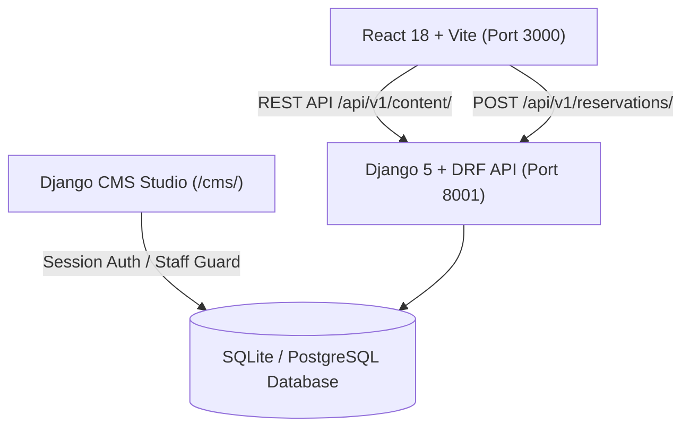

# Project 5: VERDANT — Tropical Contemporary Restaurant Platform
## PRD 04 — Tropical Modernism | Nature-Inspired Luxury | Decoupled Architecture

[](http://127.0.0.1:3000/)
[](http://127.0.0.1:8001/cms/)
[](http://127.0.0.1:3000/#tour)

---

## 1. Executive Summary & Design Direction

**VERDANT** is a premium, cinematic, 3D animated restaurant platform built in strict adherence to **PRD 04 — Tropical Contemporary Restaurant Website**.

### Core Design Philosophy
> **"NATURE IN FORM. FLAVOR IN EVERY DETAIL."**

The platform creates an organic harmony between contemporary dining, lush sub-tropical landscaping, open-air timber architecture, and nature-inspired gastronomy:
- **Tropical Modernism Palette**: Deep Forest Green (`#1A2F25`, `#243F32`), Sage Mist (`#AAB9A0`), Warm Ivory (`#F6F2E9`), Natural Sand (`#E5D7C2`), Honed Limestone (`#C8B99F`), Teak Timber (`#76533C`), Terracotta (`#BC7153`), Citrus Yellow (`#D9B84E`).
- **Typography Scale**: Editorial serif headings in *Cormorant Garamond*, body in *DM Sans*, UI controls in *Manrope*, and spatial coordinates in *DM Mono*.
- **Directional Lighting & Text Contrast**: Left-directional dark gradient veil over the hero scene guarantees razor-sharp text visibility while allowing the right-anchored 3D tropical pavilion to bask in warm natural sunlight.
- **Permanent Left Architectural Sidebar**: The Decoupled Django CMS Studio (`/cms/`) features a permanent left sidebar (`290px`) with instant search `#sidebarFilter` and 1-click anchors to all 10 management modules.

---

## 2. System Architecture



- **Frontend (Port 3000)**: React 18, Vite, Three.js, React Three Fiber, Drei.
- **Backend (Port 8001)**: Django 5, Django REST Framework, CORS Headers.
- **Database**: SQLite (Development) / PostgreSQL (Production).

---

## 3. The 15 Full-Featured Homepage Sections

1. **S01 — Hero Section**: Monumental headline *"WHERE NATURE MEETS THE TABLE."*, live status pill *"CANOPY PAVILION OPEN"*, 3D WebGL interactive pavilion, directional dark veil, and metrics strip (72 PAX, 10 courses, 180 varietals).
2. **S02 — Editorial Introduction**: `.ivory-theme` featuring architectural philosophy and lifestyle photography.
3. **S03 — Guiding Philosophy**: 3 bedrock pillars (*01 Nature*, *02 Craft*, *03 Hospitality*) in forest green cards.
4. **S04 — Signature Dishes**: Chef-curated highlights with modal trigger, seasonal badges, and dietary pills.
5. **S05 — Menu Explorer**: 7 categories (Starters, Salads & Botanicals, Hearth & Embers, Coastal Seafood, Desserts, Cocktails, Wine), real-time search, dietary filter pills (All, GF, DF, VG, V), and tasting menu banner.
6. **S06 — Culinary Story**: `.sand-theme` 4-stage narrative (*Inspiration*, *Ingredients*, *Preparation*, *Presentation*).
7. **S07 — Tropical Architecture**: Material breakdown (*Reclaimed Teak*, *Limestone*, *Fluted Glass*, *Living Canopy*) with Atelier Verdant specifications.
8. **S08 — 3D Virtual Tour**: Embedded `<RestaurantTour />` with 5 spatial viewpoints, camera lerp transitions, single-brace `<Html>` pulsing terracotta hotspots, and high-res photo archive fallback.
9. **S09 — Dining Experience**: 3 dimensions (*The Atmosphere*, *The People*, *The Moment*).
10. **S10 — Botanical Archive (Gallery)**: Masonry photo gallery with categories and fullscreen `<Lightbox />` viewer.
11. **S11 — Guest Testimonials**: 5-star critic reviews (Michelin Guide, Architectural Digest, Travel + Leisure).
12. **S12 — Table Reservations**: In-page booking terminal submitting to `/api/v1/reservations/` with instant `TROP-` reference code confirmation.
13. **S13 — Location & Hours**: 2-column contact, GPS coordinates, weekly schedule, and botanical map schematic.
14. **S14 — Frequently Asked Questions**: 8-item interactive accordion in `.ivory-theme`.
15. **S15 — Colophon & Logistics Footer**: Closing statement *"GOOD FOOD. NATURAL SPACES. BETTER MOMENTS."*, 4-column logistics grid, hours, address, and direct CMS Studio credentials helper.

---

## 4. Decoupled Django CMS Studio (`/cms/`)

The CMS Studio provides comprehensive real-time control over all restaurant data:
- **Permanent Left Sidebar (`#cmsSidebar`)**: 290px fixed width with `#sidebarFilter` instant search for quick navigation across 10 modules:
  1. `#overview`: Real-time telemetry KPIs (Total Reservations, Active Menu Items, Viewpoints, Gallery Images).
  2. `#section-settings`: Core restaurant details, address, hours, and branding.
  3. `#section-reservations`: Live triage desk with status controls (Pending, Contacted, Confirmed, Cancelled).
  4. `#section-menu`: Category-grouped menu inventory with instant availability toggle.
  5. `#section-tour`: Spatial viewpoint camera coordinates and hotspot details.
  6. `#section-editorial`: Section titles, subtitles, and custom copy overrides.
  7. `#section-gallery`: Botanical photo archive manager with category tagging.
  8. `#section-testimonials`: Guest review curator with star ratings.
  9. `#section-faqs`: Interactive FAQ accordion manager.
  10. `#section-json`: Master JSON emergency import/export editor.

### Studio Credentials
- **URL**: [http://127.0.0.1:8001/cms/](http://127.0.0.1:8001/cms/)
- **Username**: `admin`
- **Password**: `adminpassword123`

---

## 5. Quickstart & Execution Guide

### Step 1: Start Backend (Django 5)
```bash
cd "project 5/backend"
python3 -m venv venv && source venv/bin/activate # (optional)
pip install django djangorestframework django-cors-headers
python3 manage.py migrate
python3 manage.py seed_data   # Seeds all 15 sections, menu items, and viewpoints
python3 manage.py runserver 127.0.0.1:8001
```

### Step 2: Start Frontend (React 18 + Vite)
```bash
cd "project 5/frontend"
npm install
npm run dev -- --port 3000 --host 127.0.0.1
```

### Step 3: Run End-to-End Verification Test
```bash
python3 "project 5/verify_project5.py"
```

---

## 6. Verification Status

All automated checks passed:
- `✓ Content API OK`: 200 OK with all 15 sections, 7 categories, and 5 viewpoints.
- `✓ Reservation API OK`: 201 Created returning unique `TROP-` code.
- `✓ CMS Studio OK`: Authentication, permanent left sidebar `#cmsSidebar`, and 10 modules verified.
- `✓ Frontend DOM & 3D OK`: All 15 sections rendered, 2 Three.js WebGL canvases active, dish and reservation modals functioning with 0 console errors.
